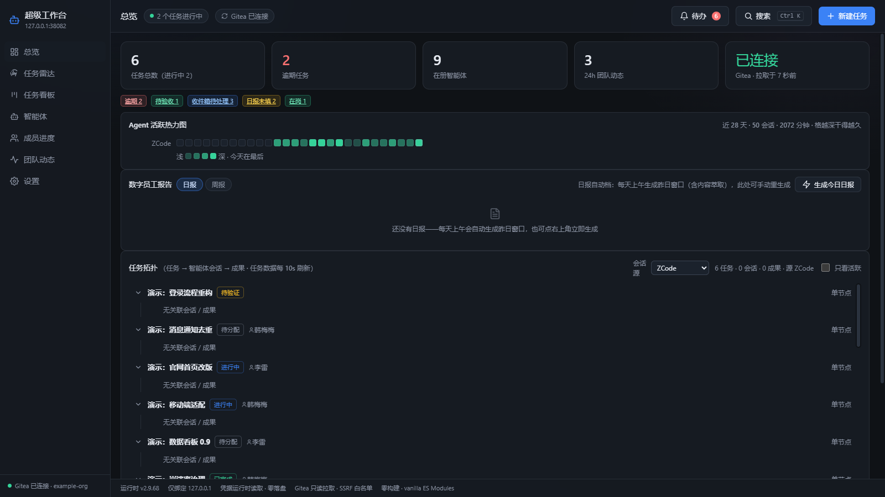
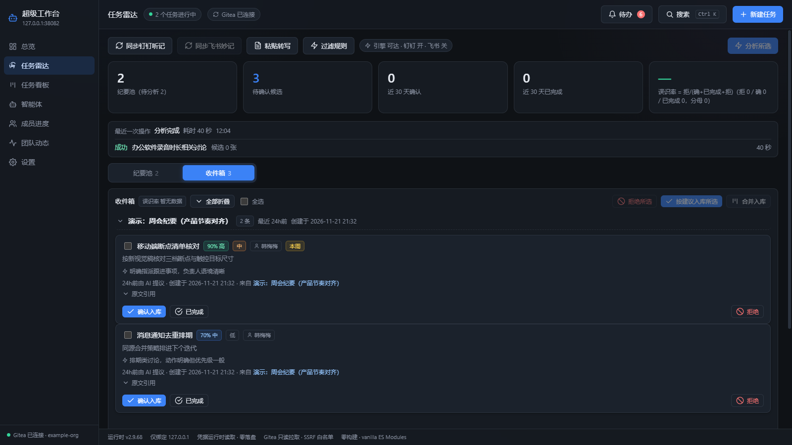
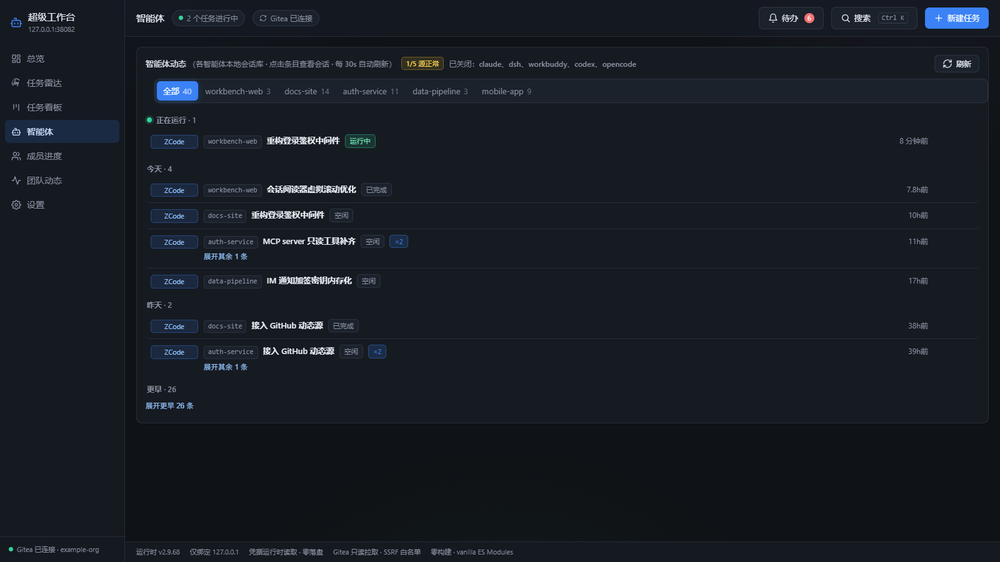
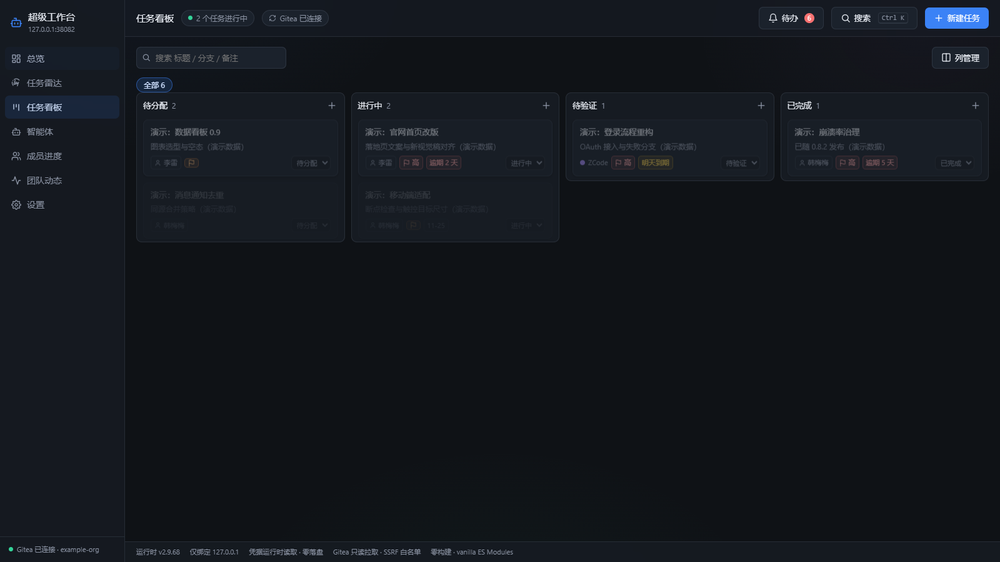
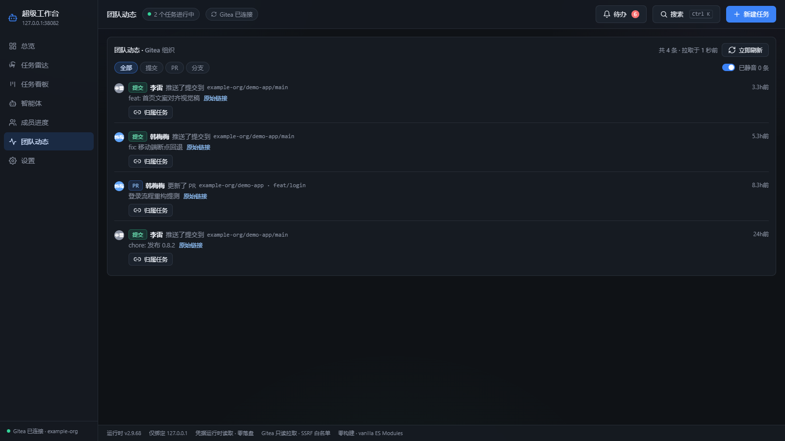

# Super Workbench (fde-console)

[English](README.md) | [中文文档](README.zh-CN.md)

[](https://github.com/ningL32/agent-workbench/actions/workflows/test.yml)
[](LICENSE)


A local-first workbench plugin for [DSH](https://www.npmjs.com/package/@deepseek-ai/dsh) that turns the AI coding agents already running on your machine (ZCode, Claude Code, Codex, OpenCode, DSH, WorkBuddy…) into an **observable, accountable team**.



**The core loop: See → Understand → Attribute → Accept.**

- **See** — live agent activity across six local session sources (per-project feed, running-now section, 28-day heatmap)
- **Understand** — full transcript reader per session, plus the *dispatch prompt*: the original human instruction behind each session
- **Attribute** — commits and sessions auto-attached to tasks via a branch/markdown convention ([docs/ATTRIBUTION.md](docs/ATTRIBUTION.md)), with a repo guard against cross-repo false matches
- **Accept** — evidence lives on the task: timeline, session evidence with one-click confirm, daily/weekly reports with Markdown export

**Local-first by design:** no cloud, no third-party runtime dependencies (Node built-ins only), all data in one directory you own. Agent sessions are read-only observed — the workbench never writes into your agents.

## Screenshots

| Task Radar — meeting transcript → AI decomposition → inbox gate | Agents — six-source session feed with running-now detection |
|---|---|
|  |  |

| Task Board — kanban with timeline, acceptor, overdue flags | Team Activity — multi-source commit/PR feed with task attribution |
|---|---|
|  |  |

*(screenshots show the fully synthetic demo dataset — `scripts/seed-demo.js`)*

## Features

- **Task board** — kanban with timeline, acceptor sign-off, deep links, priorities, due dates, daily diary per task
- **Agent observation** — six-source adapters, session lists, transcript reader, running-now detection, per-project tabs
- **Work search** — `Ctrl+K` across task titles, session titles, commit messages and diaries
- **Dispatch prompts** — see the original instruction each agent session was started with
- **Session evidence** — suggested attachments scored per task, one-click or batch confirm
- **Reports** — auto-generated daily digest and weekly review, exportable as Markdown
- **Heatmap & scorecards** — 28-day activity grid per agent; SVG scorecard endpoints
- **Integrations** — MCP server (stdio) so your agents can query the board; webhook out; IM notify (Feishu/DingTalk bots); Gitea/GitHub/Gitee activity feeds
- **Governance** — credential never touches disk (git config runtime read), redaction on every output, SSRF allowlist for all outbound, single-instance lock with warning, backup/restore

## Requirements

| | |
|---|---|
| OS | Windows (verified; macOS/Linux not yet tested) |
| Node.js | **≥ 22.13** (uses built-in `node:sqlite`) |
| DSH | 0.2.1-rc.2 (`@deepseek-ai/dsh`) |
| pnpm | on PATH (plugin install forwards to it) |

## Quick start

```bash
# 1. install / update the plugin into a profile (the profile is created on first use)
dsh plugin --profile fde-dev add <this repo path>

# 2. a fresh profile ships @deepseek-ai/dsh-base only — the web surface bundle is separate.
#    Without it the plugin loads but never activates:
#      "fde-console: pending (waiting for service: webServer)"  (port never listens)
#    Pin it to your dsh version; an unpinned add resolves an incompatible old build.
dsh plugin --profile fde-dev add @deepseek-ai/dsh-web-app@0.2.1-rc.2   # ← use `dsh --version`

# 3. start (no `dsh --profile fde-dev web` — web is a reserved alias profile)
dsh --profile fde-dev --port 38082
```

Open the printed URL (auth token included) → **Super Workbench** appears in the sidebar. Your local agents are detected automatically — zero config to see your first session.

Data lives in `<DSH_HOME|~/.dsh>/fde-console/` (`data/` + config). Step-by-step verification (test gate → plugin load → API round-trip → UI): [docs/VERIFY.md](docs/VERIFY.md). Full install manual: [docs/DISTRIBUTION.md](docs/DISTRIBUTION.md).

## Demo dataset

Want a populated workbench before connecting anything? Seed a fully synthetic dataset (members, tasks, minutes, inbox candidates, team events — placeholder names only, zero network):

```bash
node scripts/seed-demo.js                          # seeds the default data dir (~/.dsh/fde-console/data)
node scripts/seed-demo.js --data-dir <dir> --force # custom dir / overwrite
```

Then start the instance and explore; delete the seeded JSON files to reset.

## The seven views

| View | What it shows |
|---|---|
| Overview | stats, agent heatmap, digital-worker reports (daily/weekly), version matrix |
| Task Radar | meeting transcripts → AI task decomposition → inbox gate |
| Task Board | kanban: timeline, acceptor, deep links, diary, project filters |
| Agents | live activity feed across six sources + session reader |
| Members | desktop agents + human members: status, output, diary nudge |
| Team Activity | multi-source commit/PR feed with task attribution |
| Settings | sources, engine, security allowlist, one-click env check |

## Attribution protocol

AI-made commits can self-attach to tasks with three conventions: branch `task/<id>`, marker `[#<id>]` in the message, or binding the task to a project directory. See [docs/ATTRIBUTION.md](docs/ATTRIBUTION.md) — includes a ready-to-paste snippet for your own `AGENTS.md` and a `commit-msg` hook.

Writing your own session-source adapter (Cursor, Trae, Aider…): see [docs/ADAPTERS.md](docs/ADAPTERS.md).

## MCP server

`scripts/mcp-server.mjs` exposes read-only tools (list tasks / search work / agent status) over stdio, so any MCP client can query the workbench:

```json
{ "mcpServers": { "fde": { "command": "node", "args": ["<repo>/scripts/mcp-server.mjs"] } } }
```

## Testing

```bash
npm test   # node --test test/*.test.js — 500+ cases, zero network
```

## Documentation

Primary documentation is in Chinese under [`docs/`](docs/): [SPEC.md](docs/SPEC.md) (functional contract), [SPEC-PLUGIN.md](docs/SPEC-PLUGIN.md) (DSH plugin conformance), [SPEC-STORAGE.md](docs/SPEC-STORAGE.md) (SQLite storage design), [ATTRIBUTION.md](docs/ATTRIBUTION.md), [ADAPTERS.md](docs/ADAPTERS.md), [DISTRIBUTION.md](docs/DISTRIBUTION.md).

## Contributing

Read [AGENTS.md](AGENTS.md) before your first change — it documents the architecture invariants (zero runtime deps, no build chain, storage contracts) and the docs-as-tests discipline that the test suite enforces. `npm test` must be green in every commit.

## License

[MIT](LICENSE)
