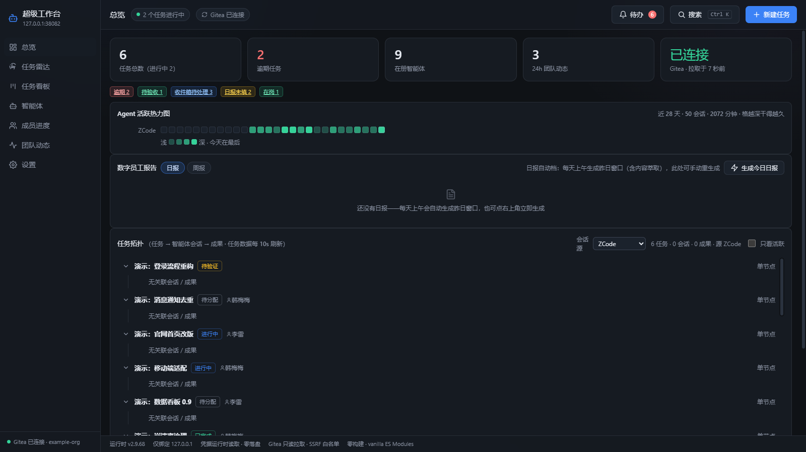
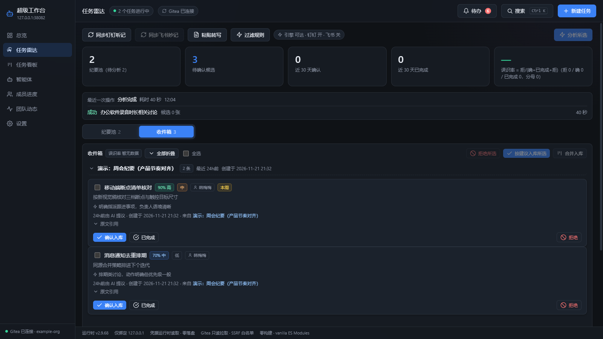
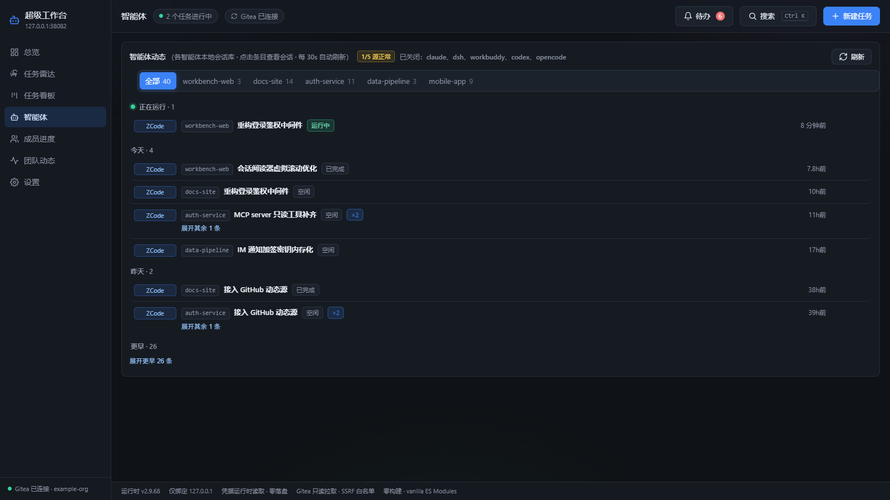
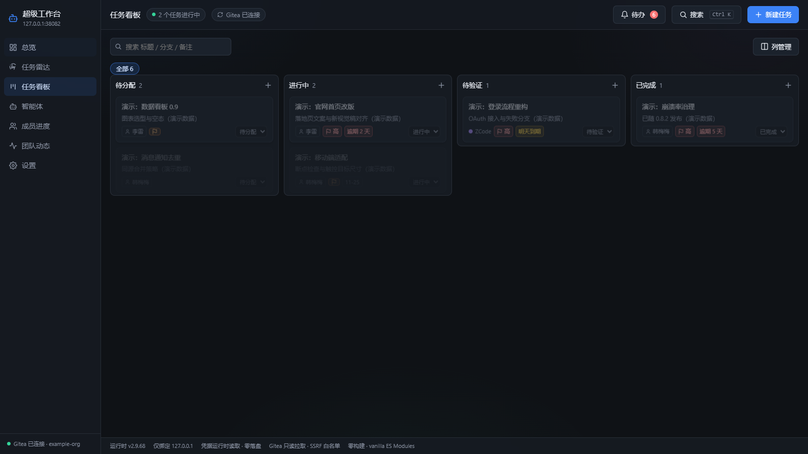
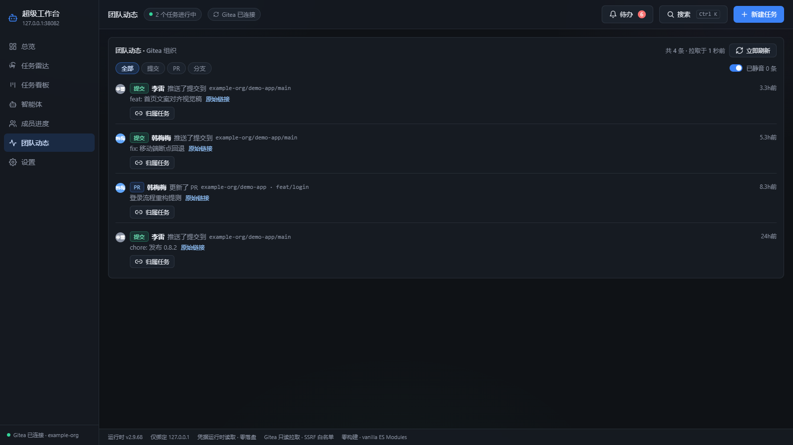

> 中文文档 | [English](README.md)

# 超级工作台（fde-console · Super Workbench）

当前版本 v2.9.96

[](https://github.com/ningL32/agent-workbench/actions/workflows/test.yml)
[](LICENSE)


一套装进 [DSH](https://www.npmjs.com/package/@deepseek-ai/dsh) 的 **local-first 工作台插件**：把已经跑在你机器上的 AI 编码智能体（ZCode、Claude Code、Codex、OpenCode、DSH、WorkBuddy…）变成一支**可观测、可问责的团队**。



**核心闭环：看见 → 理解 → 归因 → 验收。**

- **看见** —— 六个本地会话源的实时智能体动态（按项目分组、运行中区块、28 天热力图）
- **理解** —— 每条会话的全文阅读器，外加**派工词**：每条会话背后那个人下的原始指令
- **归因** —— 提交和会话按分支/标记约定自动挂到任务（[docs/ATTRIBUTION.md](docs/ATTRIBUTION.md)），附跨仓误配护栏
- **验收** —— 证据长在任务上：时间轴、会话证据一键确认、日报/周报 Markdown 导出

**天生 local-first：** 无云依赖、零第三方运行时依赖（只用 Node 内置模块），所有数据都在你自己的一个目录里。智能体会话只读观测——工作台从不写进你的智能体。

## 界面速览

| 任务雷达 —— 会议转写 → AI 拆解 → 收件箱闸门 | 智能体 —— 六源会话流 + 运行中检测 |
|---|---|
|  |  |

| 任务看板 —— 时间轴/验收人/逾期标示 | 团队动态 —— 多源 commit/PR 流 + 任务归因 |
|---|---|
|  |  |

*（截图来自全合成演示数据集——`scripts/seed-demo.js`）*

## 功能清单

- **场景调研** —— 访谈客户 → AI 草稿 → 人工闸门 → 带证据任务入看板;知识库沉淀历史场景复利下次访谈(SPEC-RESEARCH.md)
- **任务看板** —— 看板 + 时间轴、验收人签收、深链、优先级、截止日、每任务日报
- **智能体观测** —— 六源适配器、会话列表、全文阅读器、运行中检测、按项目分组
- **工作搜索** —— `Ctrl+K` 跨任务标题/会话标题/提交信息/日报
- **派工词** —— 看到每条智能体会话最初收到的人类指令
- **会话证据** —— 按任务打分的建议挂接，一键/批量确认
- **报告** —— 自动生成每日摘要与每周回顾，Markdown 导出
- **热力图与传播卡** —— 每个 agent 的 28 天活跃格；SVG scorecard 端点
- **集成** —— MCP Server（stdio）让任意 agent 查询看板；Webhook 出口；IM 通知（飞书/钉钉群机器人）；Gitea/GitHub/Gitee 动态流
- **治理** —— 凭据永不落盘（git config 运行时读取）、出口全量脱敏、出网 SSRF 白名单、单实例锁告警、备份/恢复

## 环境要求

| | |
|---|---|
| 操作系统 | Windows（已实测；macOS/Linux 未验证） |
| Node.js | **≥ 22.13**（依赖内置 `node:sqlite`，Node 18/20 不可用）；22.13/22.14 上 DSH 会话源只读明文 rollout，zstd 压缩的 DSH 会话日志（`zlib.zstd*`）需 ≥ 22.15，低版本自动优雅降级 |
| DSH | 0.2.1-rc.2（`@deepseek-ai/dsh`） |
| pnpm | 在 PATH（插件安装走 pnpm 转发） |

## 快速开始

```bash
# 1. 把插件装进 profile（首次执行自动创建 profile）
dsh plugin --profile fde-dev add fde-console        # npm 一行安装（推荐）
#    （若市场索引同步滞后于 npm,钉版本: fde-console@2.9.81）
#    …或从本地克隆安装：
#    dsh plugin --profile fde-dev add <本仓库路径>

# 2. 新 profile 只自带 @deepseek-ai/dsh-base —— web 界面包是独立的。
#    不装它插件会卡在 "fde-console: pending (waiting for service: webServer)"，端口永不监听。
#    版本必须与 dsh 一致（用 `dsh --version` 查），否则会被宿主判 incompatible 拒绝。
dsh plugin --profile fde-dev add @deepseek-ai/dsh-web-app@0.2.1-rc.2

# 3. 启动（没有 `dsh --profile fde-dev web` 这种用法——web 是保留的别名 profile）
dsh --profile fde-dev --port 38082
```

用启动日志打印的**带 token URL** 打开（0.2.1 起有认证门，裸地址白屏是正常防御）→ 侧栏出现「超级工作台」。本机智能体自动检测，零配置即可看到第一条会话。

数据落点 `<DSH_HOME|~/.dsh>/fde-console/`（`data/` + config）。逐档验证手册（测试门禁 → 插件装载 → 接口写读闭环 → 界面）：[docs/VERIFY.md](docs/VERIFY.md)；完整安装手册：[docs/DISTRIBUTION.md](docs/DISTRIBUTION.md)。

## 演示数据集

想在连接任何数据源之前就看到非空的工作台？灌一份全合成演示数据（成员/任务/纪要/收件箱候选/团队动态——纯占位名，零出网）：

```bash
node scripts/seed-demo.js                           # 灌缺省数据目录（~/.dsh/fde-console/data）
node scripts/seed-demo.js --data-dir <目录> --force # 自定义目录 / 覆盖
```

灌完启动实例即可查看；删掉被灌的 JSON 文件即还原。

## 七视图导览

| 视图 | 一句话 |
|---|---|
| 总览 | 统计卡 + Agent 活跃热力图 + 数字员工日报/周报 + 周期验收指标 + 晨会简报 + 版本矩阵 |
| 调研 | 客户访谈 → AI 草稿 → 人工闸门 → 带证据任务;知识库沉淀复用 |
| 任务雷达 | 钉钉听记/飞书妙记 → AI 拆解 → 收件箱闸门（确认后才入看板） |
| 任务看板 | 看板：时间轴、验收人、深链、日报、项目过滤 |
| 智能体 | 六源实时动态流 + 会话全文阅读器 |
| 成员进度 | 桌面 agent + 人类成员：状态、产出、日报提醒 |
| 团队动态 | 多源 commit/PR 流 + 任务归因 |
| 设置 | 数据源、引擎、安全白名单、一键体检 |

## 归因协议

AI 提交可用三种约定自挂任务：分支 `task/<id>`、提交信息带 `[#<id>]`、任务绑定项目目录。见 [docs/ATTRIBUTION.md](docs/ATTRIBUTION.md)——附可直接粘贴进你自己 `AGENTS.md` 的片段和一个 `commit-msg` hook。

想写自己的会话源适配器（Cursor、Trae、Aider…）：见 [docs/ADAPTERS.md](docs/ADAPTERS.md)。

## MCP Server

`scripts/mcp-server.mjs` 经 stdio 暴露只读工具（列任务/搜工作/agent 状态），任意 MCP 客户端可接入：

```json
{ "mcpServers": { "fde": { "command": "node", "args": ["<repo>/scripts/mcp-server.mjs"] } } }
```

## 测试

```bash
npm test   # node --test test/*.test.js，500+ 用例，零网络
```

## 文档

主文档在 [`docs/`](docs/)（中文）：[SPEC.md](docs/SPEC.md)（功能契约）、[SPEC-PLUGIN.md](docs/SPEC-PLUGIN.md)（DSH 插件规范符合性）、[SPEC-STORAGE.md](docs/SPEC-STORAGE.md)（SQLite 存储设计）、[ATTRIBUTION.md](docs/ATTRIBUTION.md)、[ADAPTERS.md](docs/ADAPTERS.md)、[DISTRIBUTION.md](docs/DISTRIBUTION.md)。

## 参与贡献

动手前先读 [AGENTS.md](AGENTS.md)——里面是架构红线（零运行时依赖、无构建链、存储契约）和测试套件强制执行的「文档即断言」纪律。每次提交都要保持 `npm test` 全绿。

## 许可证

[MIT](LICENSE)
